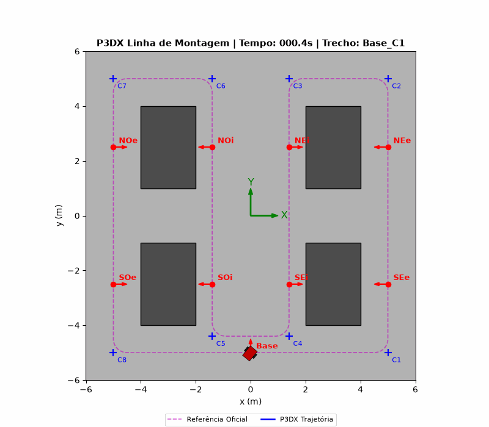
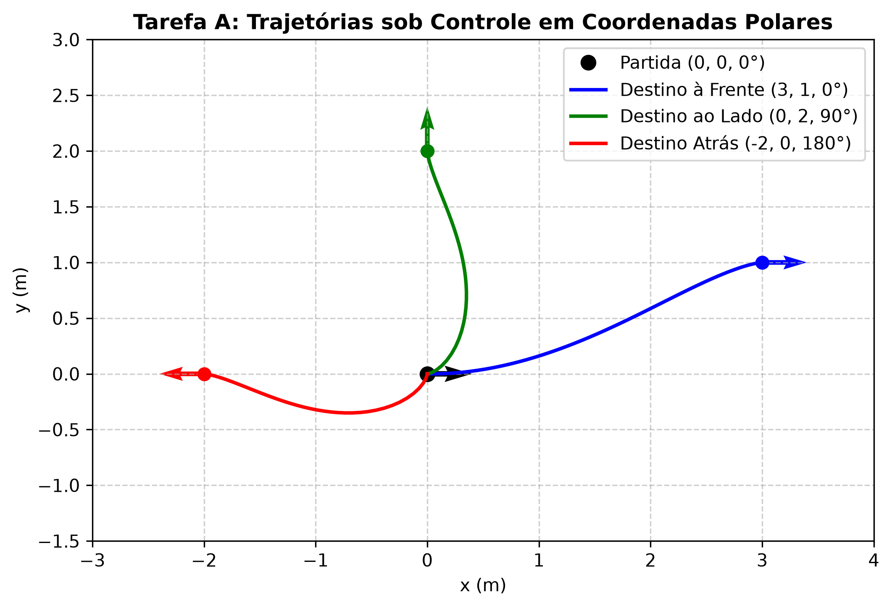
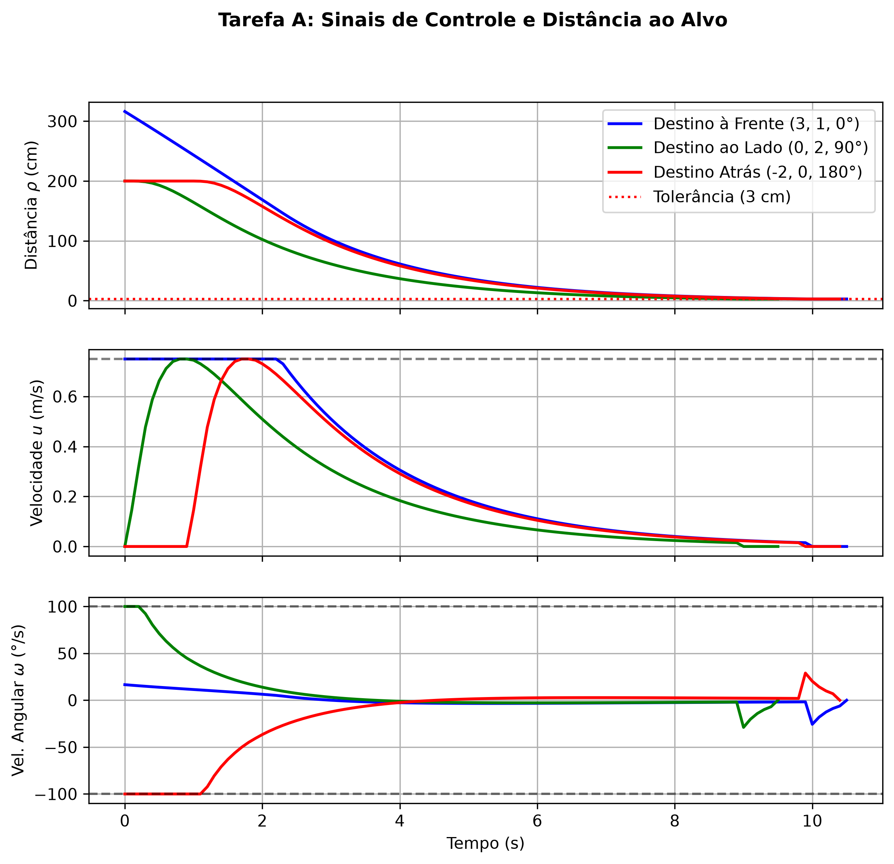
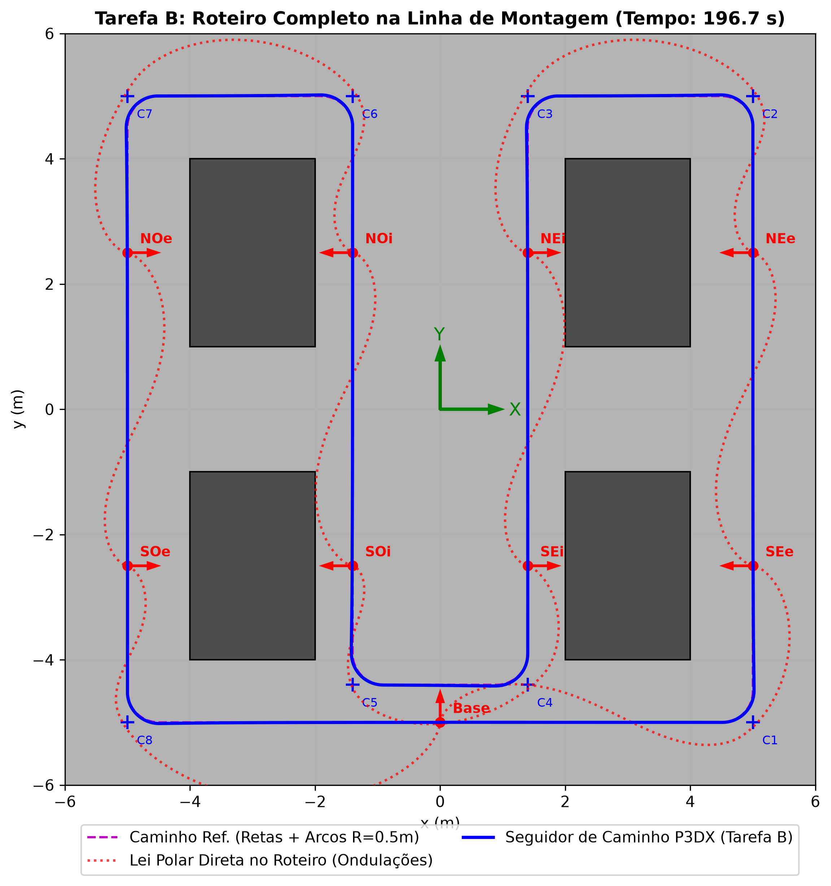
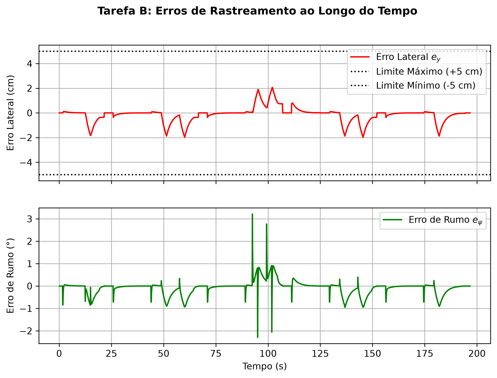
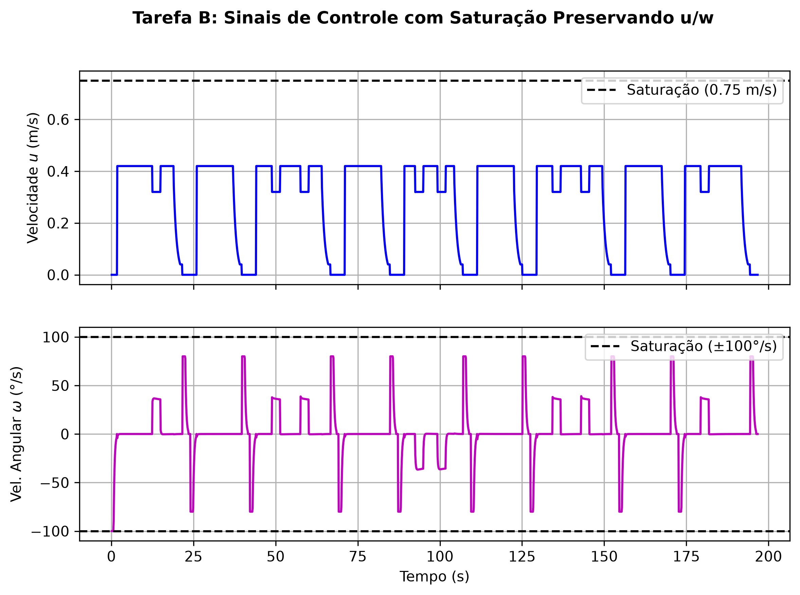
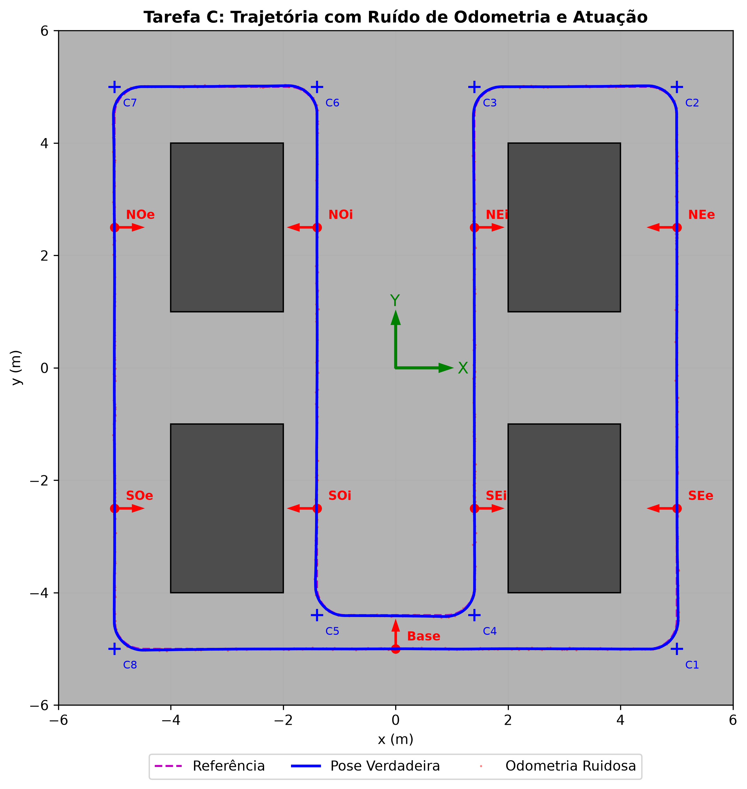
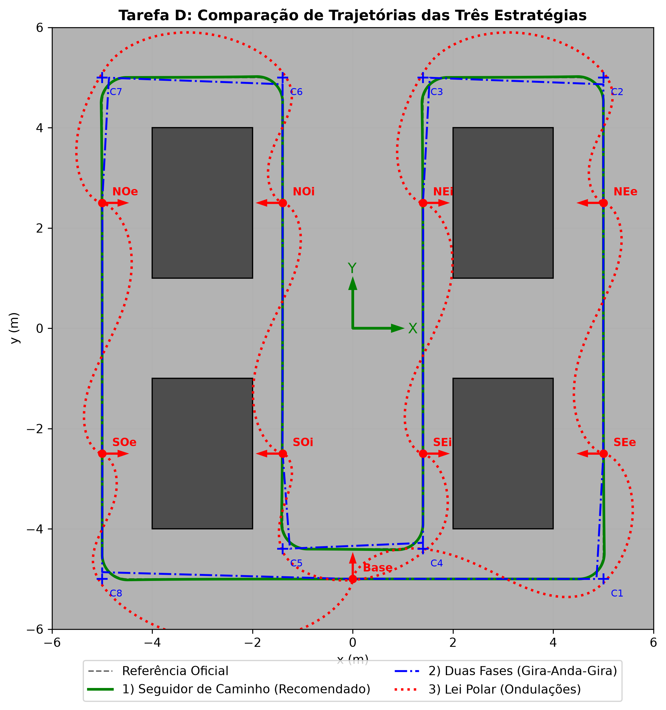
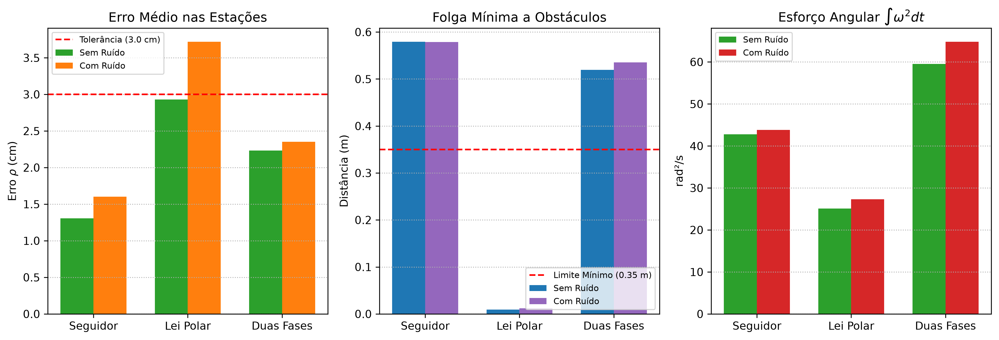

# Navegação Contínua do Pioneer 3DX na Linha de Montagem

Repositório da avaliação prática da disciplina **Robótica Terrestre** do **Instituto Federal da Bahia (IFBA — Campus Vitória da Conquista)**. O projeto implementa e avalia sistemas de controle cinemático contínuo e seguimento de caminho para o robô móvel diferencial não-holonômico **Pioneer 3DX** em um cenário industrial de linha de montagem.



---

## Sumário

1. [Visão Geral e Objetivos](#1-visão-geral-e-objetivos)
2. [Estrutura do Repositório](#2-estrutura-do-repositório)
3. [Modelagem e Leis de Controle](#3-modelagem-e-leis-de-controle)
4. [Resultados Principais](#4-resultados-principais)
5. [Como Executar](#5-como-executar)
6. [Galeria de Gráficos](#6-galeria-de-gráficos)

---

## 1. Visão Geral e Objetivos

O robô **Pioneer 3DX** (controlado pelo centro do eixo das rodas, com limites $|u| \le 0{,}75\text{ m/s}$ e $|\omega| \le 100^\circ/\text{s}$ a $10\text{ Hz}$) percorre uma linha de montagem composta por 4 blocos fabris, 8 estações de atendimento (internas e externas) e 8 quinas de passagem (`C1` a `C8`), partindo e retornando à `Base` em $(0, -5, 90^\circ)$.

As quatro tarefas implementadas no arquivo principal [`avaliacao_p3dx.py`](avaliacao_p3dx.py) são:

- **Tarefa A — Controle Contínuo até uma Pose:** Lei de controle em coordenadas polares $(\rho, \alpha, \beta)$ respeitando as condições de estabilidade de Lyapunov ($k_\rho > 0$, $k_\beta < 0$, $k_\alpha - k_\rho > 0$) e tratamento para alvos retrógrados ($|\alpha| > 90^\circ$).
- **Tarefa B — Roteiro Contínuo entre Blocos (Seguidor de Caminho):** Seguimento de caminho composto por segmentos de reta e arcos circulares tangentes de raio $R = 0{,}5\text{ m}$ nas quinas `C1` a `C8` ($57{,}1\text{ m}$ totais), contornando as curvas sem parar, mantendo desvio lateral $\le 5\text{ cm}$ e parando nas 8 estações e na Base com $\rho < 3\text{ cm}$ e $|\psi_f - \psi| < 2^\circ$. Demonstra também o efeito de ondulações caso a lei polar seja aplicada diretamente ao roteiro.
- **Tarefa C — Robustez a Ruído:** Avaliação estatística (média $\pm$ desvio padrão em 10 execuções com sementes distintas) sob ruído gaussiano de odometria ($\sigma_{x,y} = 1\text{ cm}$, $\sigma_\psi = 0{,}5^\circ$) e ruído multiplicativo de atuação ($\mathcal{N}(0, 0{,}05)$), calculando as métricas sobre a pose verdadeira do simulador.
- **Tarefa D — Comparação de Estratégias (Sem e Com Ruído):** Comparação quantitativa pelas 6 métricas da Seção 5 entre o **Seguidor de Caminho**, a **Lei Polar Ponto a Ponto** e o **Controlador em Duas Fases (Gira-Anda-Gira)**.

---

## 2. Estrutura do Repositório

```text
sistemas-autonomos-roboticos/
├── avaliacao_p3dx.py                     # Programa principal unificado (Tarefas A, B, C e D)
├── gerar_animacao_tarefa_B.py            # Gerador da animação/vídeo (GIF) da Tarefa B
├── pioneer3dx.py                         # Classe de simulação cinemática e CAD 2D/3D do Pioneer 3DX
├── cenario_linha_montagem.py             # Definição e desenho dos blocos, estações e quinas
├── Ex02_Controlador.py                   # Código-base de referência do laço de controle a 10 Hz
├── proj_P3DX_montagem.py                 # Exemplo base de posicionamento na linha de montagem
├── RELATORIO_AVALIACAO_P3DX.md           # Relatório técnico completo com análise e questões orientadoras
├── Avalição_Navegacao_Continua_P3DX.pdf  # Enunciado oficial da avaliação
└── figuras/                              # Gráficos de alta resolução e animação gerados pelo código
    ├── trajetoria_tarefa_A.png
    ├── sinais_tarefa_A.png
    ├── trajetoria_tarefa_B.png
    ├── erros_tarefa_B.png
    ├── sinais_tarefa_B.png
    ├── simulacao_tarefa_B.gif
    ├── trajetoria_tarefa_C.png
    ├── comparacao_trajetorias_tarefa_D.png
    └── comparacao_metricas_tarefa_D.png
```

---

## 3. Modelagem e Leis de Controle

### 3.1 Saturação Proporcional Preservando $u/\omega$
Para manter inalterado o raio de curvatura instantâneo $R = u/\omega$ quando qualquer comando excede os limites físicos ($u_{\max} = 0{,}75\text{ m/s}$, $\omega_{\max} = 100^\circ/\text{s}$):

$$s = \max\left(1{,}0,\, \frac{|u|}{u_{\max}},\, \frac{|\omega|}{\omega_{\max}}\right), \quad u_{\text{sat}} = \frac{u}{s}, \quad \omega_{\text{sat}} = \frac{\omega}{s}$$

### 3.2 Lei Polar (Tarefa A)
$$\rho = \sqrt{(x_d - x)^2 + (y_d - y)^2}, \quad \alpha = \text{atan2}(y_d - y,\, x_d - x) - \psi, \quad \beta = \psi_f - \psi - \alpha$$

$$u = k_\rho \rho \max(\cos\alpha, 0), \quad \omega = k_\alpha \alpha + k_\beta \beta$$

com ganhos $k_\rho = 0{,}50\text{ s}^{-1}$, $k_\alpha = 1{,}50\text{ s}^{-1}$ e $k_\beta = -0{,}30\text{ s}^{-1}$.

### 3.3 Seguidor de Caminho (Tarefa B)
$$u = \text{clip}\big(u_{\text{ref}} \max(\cos e_\psi, 0),\, -u_{\max},\, u_{\max}\big), \quad \omega = u \kappa + k_\psi e_\psi - k_y u e_y$$

com ganhos $k_\psi = 5{,}0\text{ s}^{-1}$, $k_y = 10{,}0\text{ m}^{-2}$, $u_{\text{nom}} = 0{,}42\text{ m/s}$ (retas) e $u_{\text{arc}} = 0{,}32\text{ m/s}$ (curvas de raio $R = 0{,}5\text{ m}$, $\kappa = \pm 2{,}0\text{ m}^{-1}$).

---

## 4. Resultados Principais

### Resumo Comparativo das Estratégias (Tarefa D — Sem e Com Ruído)

| Métrica (Seção 5) | Seguidor de Caminho (Sem / Com Ruído) | Lei Polar (Sem / Com Ruído) | Duas Fases (Sem / Com Ruído) | Requisito |
| :--- | :---: | :---: | :---: | :---: |
| **1. Tempo total (s)** | $196{,}7$ / $195{,}3$ | $209{,}7$ / $204{,}7$ | $184{,}1$ / $184{,}0$ | $\le 300\text{ s}$ |
| **2. Comprimento percorrido (m)** | **$57{,}21$ / $57{,}20$** | $66{,}36$ / $66{,}32$ | $57{,}69$ / $57{,}85$ | Ref: $57{,}1\text{ m}$ |
| **3. Erro médio $\rho$ estações (cm)** | **$1{,}31$ / $1{,}60$** | $2{,}93$ / **$3{,}72$ (Viola!)** | $2{,}23$ / $2{,}35$ | $< 3{,}0\text{ cm}$ |
| **3. Erro médio $\|\Delta\psi\|$ estações (°)** | **$0{,}73^\circ$ / $0{,}61^\circ$** | $1{,}13^\circ$ / $1{,}13^\circ$ | $1{,}29^\circ$ / $1{,}21^\circ$ | $< 2{,}0^\circ$ |
| **4. Desvio da ref. Máximo (cm)** | **$2{,}06$ / $3{,}06$** | $125{,}65$ / $124{,}16$ | $12{,}68$ / $14{,}65$ | $\le 5{,}0\text{ cm}$ |
| **4. Desvio da ref. RMS (cm)** | **$0{,}68$ / $0{,}77$** | $36{,}29$ / $36{,}80$ | $4{,}82$ / $4{,}82$ | — |
| **5. Folga mín. obstáculos (m)** | **$0{,}579$ / $0{,}579$** | **$0{,}009$ / $0{,}012$ (Viola!)** | $0{,}519$ / $0{,}536$ | $\ge 0{,}35\text{ m}$ |
| **6. Esforço linear $\int u^2 dt$ ($\text{m}^2/\text{s}$)** | **$22{,}73$ / $22{,}75$** | $37{,}02$ / $36{,}76$ | $25{,}39$ / $25{,}60$ | — |
| **6. Esforço angular $\int \omega^2 dt$ ($\text{rad}^2/\text{s}$)** | **$42{,}77$ / $43{,}84$** | $25{,}11$ / $27{,}32$ | $59{,}53$ / $64{,}82$ | — |

Para a análise completa e respostas detalhadas às 6 questões orientadoras, consulte o relatório em [`RELATORIO_AVALIACAO_P3DX.md`](RELATORIO_AVALIACAO_P3DX.md).

---

## 5. Como Executar

### Pré-requisitos
Apenas Python 3 com `numpy` e `matplotlib` instalados:
```bash
pip install numpy matplotlib
```

### Seleção por Variáveis no Topo do Código
No topo de [`avaliacao_p3dx.py`](avaliacao_p3dx.py), ajuste as variáveis:
```python
TAREFA = 'B'            # 'A', 'B', 'C', 'D' ou 'TODAS'
HABILITAR_RUIDO = False # True ou False
ANIMACAO = False        # True para exibir animação 2D passo a passo
```
Em seguida, execute:
```bash
python avaliacao_p3dx.py
```

### Execução Direta via Linha de Comando
Você também pode passar a tarefa e opções diretamente pelo terminal:
```bash
# Executar uma tarefa específica
python avaliacao_p3dx.py A
python avaliacao_p3dx.py B
python avaliacao_p3dx.py B --ruido
python avaliacao_p3dx.py B --animar
python avaliacao_p3dx.py C
python avaliacao_p3dx.py D

# Executar todas as tarefas em sequência e gerar todas as figuras
python avaliacao_p3dx.py TODAS
```

---

## 6. Galeria de Gráficos

### Tarefa A — Controle Contínuo até uma Pose (Lei Polar)
| Trajetórias $(x, y)$ | Sinais de Controle e Distância $\rho$ |
| :---: | :---: |
|  |  |

### Tarefa B — Seguidor de Caminho Contínuo na Linha de Montagem
| Trajetória no Cenário | Erros Lateral ($e_y$) e de Rumo ($e_\psi$) | Sinais de Controle ($u, \omega$) |
| :---: | :---: | :---: |
|  |  |  |

### Tarefa C e Tarefa D — Robustez a Ruído e Comparação de Estratégias
| Tarefa C (Com Ruído de Odometria e Atuação) | Tarefa D (Trajetórias Comparadas) |
| :---: | :---: |
|  |  |


